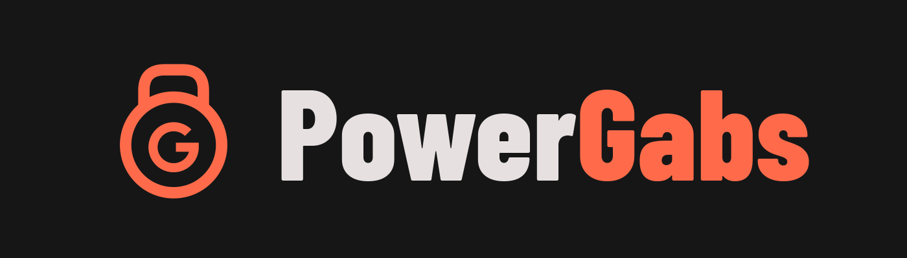

<p align="center">
  
</p>

# PowerGabs

App Android que monta sugestões de treino de acordo com o **objetivo** do usuário (Hipertrofia, Força, Resistência ou Condicionamento) e o **grupo muscular do dia**, usando os exercícios da API pública [wger](https://wger.de). Cada exercício vem com uma **prescrição** de séries, repetições e descanso, e as funcionalidades principais funcionam **sem internet**.

> Trabalho acadêmico desenvolvido com Spec-Driven Development (SDD). Os documentos de cada fase estão em [`docs/`](docs/).

## Objetivo e problema resolvido

Quem treina sozinho costuma chegar à academia sem saber quais exercícios fazer para um grupo muscular nem quantas séries e repetições combinam com o próprio objetivo. A informação existe, mas está espalhada e nem sempre acessível sem internet (academias em subsolo, plano de dados limitado). O PowerGabs junta essas respostas em poucos toques e guarda tudo no aparelho.

## Funcionalidades implementadas

| Funcionalidade | Requisito |
|---|---|
| Cadastro, login e logout **locais** (conta guardada no aparelho, senha com hash PBKDF2) | RF01–RF04 |
| Sessão mantida: depois do login, o app abre direto, com ou sem internet | RF03 |
| Seleção do objetivo (grade 2×2) | RF05 |
| Seleção do grupo muscular do dia, com aviso de descanso | RF06, RF09 |
| Lista de exercícios sugeridos com prescrição, pull-to-refresh e "atualizado há…" | RF07, RF08 |
| Detalhes: imagem, nome, descrição, músculos, equipamentos e prescrição | RF10 |
| Vídeo de execução (wger) quando existir; aviso quando não há vídeo ou internet | RF11 |
| "Meu treino": adicionar (sem duplicar), filtrar por status, marcar como feito e registrar esforço (1 a 5) | RF12–RF15 |
| Faixa "Você está sem internet" | RF16 |
| Lembrete diário às 18:00 (WorkManager) | RF17 |
| Tela "Sobre" com crédito à wger (CC-BY-SA 4.0), fontes e aviso de saúde | RF18 |
| Temas claro e escuro conforme o sistema | RNF09 |

### Prescrição por objetivo (regras do domain)

| Objetivo | Séries | Repetições | Descanso | Seleção de exercícios |
|---|---|---|---|---|
| Hipertrofia | 3–4 | 8–12 | 60–90 s | Grupo escolhido, qualquer equipamento |
| Força | 3–5 | 3–6 | 120–180 s | Só exercícios com Barra ou Halteres |
| Resistência | 2–3 | 15–20 | 30–60 s | Grupo escolhido, inclusive peso corporal |
| Condicionamento | 2–3 | 12–15 | 30 s | Grupo escolhido + categoria Cardio |

Outras regras: nome em português quando houver (senão inglês; sem nenhum dos dois, o exercício é descartado), exercícios com imagem primeiro, sem duplicados, cache de 24 h por grupo, aviso de descanso se o grupo foi concluído no dia anterior, status `PLANNED → DONE` sem volta, esforço de 1 a 5 só para exercícios feitos. Detalhes em [`docs/01-especificacao.md`](docs/01-especificacao.md).

## Tecnologias e bibliotecas

| Área | Tecnologia |
|---|---|
| Linguagem | Kotlin 2.4 |
| UI | Jetpack Compose + Material 3 (BOM 2026.09.00), fontes Barlow embutidas |
| Navegação | Navigation Compose 2.10 com rotas type-safe (`@Serializable`) |
| Injeção de dependências | Koin 4.2 |
| Assíncrono | Coroutines, Flow e StateFlow; `collectAsStateWithLifecycle` |
| Rede | Retrofit 3 + OkHttp 5 + kotlinx.serialization |
| Persistência | Room 2.8 (KSP) |
| Imagens | Coil 3 (cache em memória e em disco) |
| Vídeo | Media3 ExoPlayer 1.11 |
| Autenticação | Local: Room + PBKDF2 (`javax.crypto`) |
| Notificações | WorkManager 2.12 + NotificationCompat |
| Testes | JUnit 4, MockK, kotlinx-coroutines-test, Turbine |
| Build | Gradle Kotlin DSL + Version Catalog, AGP 9.5, `minSdk 24`, `targetSdk 37`, desugaring de `java.time` |

## API: wger

- Site: <https://wger.de> · API: <https://wger.de/api/v2/> · Documentação: <https://wger.readthedocs.io>
- Endpoint usado: `GET exerciseinfo/?category={id}&limit=100&offset={n}` (paginado até `next == null`).
- IDs de categorias, equipamentos e idiomas consultados na API real e registrados em [`docs/01-especificacao.md`](docs/01-especificacao.md), seção 8.

**Por que a wger?**
1. **Gratuita e sem chave** para leitura: não há segredo para proteger dentro do APK.
2. **Conteúdo certo para o problema:** cada exercício traz categoria (grupo muscular), músculos, equipamentos, imagens e vídeos.
3. **Traduções em português** para parte dos exercícios (ex.: 50 de 90 em Peito), com inglês como reserva.
4. **Licença aberta** (CC-BY-SA 4.0), compatível com um projeto acadêmico com atribuição.
5. **Projeto open source** mantido, com API navegável e documentada.

## Arquitetura

Clean Architecture em um único módulo `:app`, separada por pacotes, com regra de dependência rígida:

```
presentation  →  domain  ←  data
     ↑             ↑          ↑
     └──── di (Koin) conhece todas as camadas
core: AppResult, AppError, AppDispatchers, NetworkMonitor, TimeProvider
```

| Camada | Conteúdo |
|---|---|
| `domain` | Modelos, interfaces de repositório, **regras de negócio** (`domain/rule`) e casos de uso. Kotlin puro: não importa Android, Retrofit, Room, Media3 nem Koin. |
| `data` | Retrofit (`WgerApi`, DTOs), Room (entidades, DAOs), mappers, repositórios, autenticação local e o Worker do lembrete. DTOs e entidades não saem daqui. |
| `presentation` | Telas Compose (Route + Screen sem estado), ViewModels com `StateFlow<UiState>`, navegação, tema e componentes. Só fala com casos de uso. |
| `di` | Módulos Koin (`coreModule`, `dataModule`, `domainModule`, `presentationModule`). |

Detalhes, modelo de dados e decisões em [`docs/02-planejamento.md`](docs/02-planejamento.md).

## Estratégia Offline First

- O **Room é a única fonte de verdade**: as telas observam `Flow` do banco; a rede só atualiza o banco.
- Ao abrir um grupo, o app mostra o cache na hora e só busca na API se o cache estiver vazio ou tiver **24 h ou mais**.
- A busca é **tudo ou nada**: todas as páginas precisam chegar; a troca do cache do grupo é feita numa **transação** do Room.
- Falha **com** cache → os dados continuam na tela e aparece um Snackbar. Falha **sem** cache → estado de erro com "Tentar novamente".
- **Pull-to-refresh** força a busca; sem internet, avisa "Sem internet: não foi possível atualizar." e mantém o cache.
- Trocar de objetivo **não** faz nova requisição: a prescrição é calculada no domain sobre o cache.
- Detalhes já carregados funcionam offline; imagens vêm do cache em disco do Coil (sem cache, aparece o espaço reservado com haltere).
- O vídeo exige internet; offline, a área do vídeo explica isso.
- Login, sessão e "Meu treino" são totalmente locais.
- O monitor de conectividade (`ConnectivityManager.NetworkCallback` → `Flow<Boolean>`) alimenta a faixa "sem internet".

## Configuração e execução

Requisitos: Android Studio recente (JDK 21+ embutido) e SDK Android 37.

1. Clone o repositório e abra a pasta no Android Studio.
2. Aguarde a sincronização do Gradle.
3. Execute a configuração `app` em um emulador ou aparelho (Android 7.0 ou superior).

Linha de comando:

```bash
./gradlew assembleDebug        # gera app/build/outputs/apk/debug/app-debug.apk
./gradlew installDebug         # instala no emulador/aparelho conectado
```

Não é preciso chave de API nem arquivo de configuração externo: a wger permite leitura pública e a autenticação é local. O APK de depuração também está em [`entrega/`](entrega/).

## Testes

```bash
./gradlew testDebugUnitTest
```

Relatório HTML: `app/build/reports/tests/testDebugUnitTest/index.html`.

**168 testes unitários (JVM), todos aprovados**, cobrindo:

| Camada | O que é testado |
|---|---|
| domain/rule | Todas as regras de negócio (prescrição, seleção, idioma, ordenação, duplicados, cache 24 h, descanso, status, esforço, credenciais, lembrete) |
| domain/usecase | Cadastro/login, sugestões, atualização do cache, detalhes, treino, aviso de descanso |
| data | Desserialização do JSON real da wger, mappers, HTML → texto, repositórios (paginação, transação, conversão de erros), hash de senha, autenticação, agendamento do lembrete |
| presentation | Todos os ViewModels (com Turbine e `StandardTestDispatcher`) e os formatadores |

O histórico de execuções, as correções feitas e a tabela critério de aceite → verificação estão em [`TEST_RESULTS.md`](TEST_RESULTS.md).

## Evidências

Capturas do emulador (Android 17 / API 37) em [`docs/evidencias/`](docs/evidencias/):

| # | Tela | # | Tela |
|---|---|---|---|
| 01 | [Login](docs/evidencias/01-login.png) | 11 | [Offline: abre logado](docs/evidencias/11-offline-abre-logado.png) |
| 02 | [Cadastro com validação](docs/evidencias/02-cadastro-validacao.png) | 12 | [Offline: lista do cache](docs/evidencias/12-offline-lista-cache.png) |
| 03 | [Objetivo](docs/evidencias/03-objetivo.png) | 13 | [Offline: pull-to-refresh](docs/evidencias/13-offline-pull-to-refresh.png) |
| 04 | [Grupo muscular](docs/evidencias/04-grupo-muscular.png) | 14 | [Offline: detalhes e vídeo](docs/evidencias/14-offline-detalhes-video.png) |
| 05 | [Lista (Força + Peito)](docs/evidencias/05-lista-forca-peito.png) | 15 | [Offline: grupo sem cache](docs/evidencias/15-offline-grupo-sem-cache.png) |
| 06 | [Detalhes](docs/evidencias/06-detalhes.png) | 16 | [Offline: Meu treino](docs/evidencias/16-offline-meu-treino.png) |
| 07 | [Vídeo](docs/evidencias/07-video.png) | 17 | [Tema escuro: lista](docs/evidencias/17-tema-escuro-lista.png) |
| 08 | [Meu treino](docs/evidencias/08-meu-treino.png) | 18 | [Tema escuro: objetivo](docs/evidencias/18-tema-escuro-objetivo.png) |
| 09 | [Sobre](docs/evidencias/09-sobre.png) | 19 | [Logout e senha errada](docs/evidencias/19-logout-e-senha-errada.png) |
| 10 | [Notificação diária](docs/evidencias/10-notificacao.png) | | |

## Limitações conhecidas e funcionalidades não implementadas

- **Conta só no aparelho:** a autenticação é local (decisão do projeto, sem Firebase). A conta e o "Meu treino" não passam para outro aparelho, não há recuperação de senha e desinstalar o app apaga os dados.
- **Primeiro acesso a um grupo exige internet.** Sem cache, aparece o erro com "Tentar novamente".
- **Idioma:** nem todo exercício da wger tem tradução em português; nesses casos o nome e a descrição aparecem em inglês.
- **Vídeos:** poucos exercícios da wger têm vídeo, e ele exige internet. No emulador, o decodificador "goldfish" falhou com esses vídeos; o app prefere o decodificador de software do Android (ver decisões no planejamento).
- **Horário do lembrete fixo** (18:00); não há tela de configuração.
- **Aviso de descanso** verificado por testes unitários; não há captura de tela porque exige um treino concluído no dia anterior.
- **Prescrição geral:** as faixas são referências, não prescrição individual.
- Fora do escopo: contas e treinos da wger, sincronização na nuvem, planos de dieta, busca livre por texto e login social.

## Créditos

- **Exercícios, imagens e vídeos:** [wger](https://wger.de), licenciados sob [CC-BY-SA 4.0](https://creativecommons.org/licenses/by-sa/4.0/). Créditos também na tela "Sobre" do app.
- **Fontes:** Barlow e Barlow Condensed, © The Barlow Project Authors ([github.com/jpt/barlow](https://github.com/jpt/barlow)), sob a SIL Open Font License 1.1 ([`docs/licencas/OFL-Barlow.txt`](docs/licencas/OFL-Barlow.txt)).
- **Ícones:** Material Icons/Material Symbols (Google, Apache 2.0). Ícone e logo do PowerGabs fornecidos pelo responsável do projeto.

> As sugestões são gerais e não substituem a orientação de um profissional de educação física.
